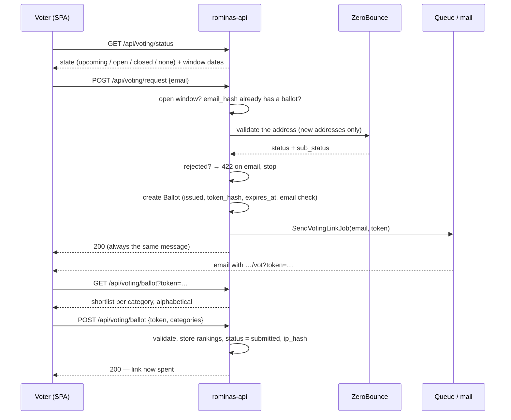

# Public voting

The public half of the Rominas vote. Anyone can request a voting link by email, rank the shortlisted
nominees, and vote **once**. There are no accounts: holding the link's token is the only authorization, and
no plaintext personal data is ever stored.

Everything here lives in `app/Modules/Voting/`. The `Ballot` / `BallotRanking` fields are in
[domain-model.md](domain-model.md#voting); the endpoint summary is in
[access-control.md §2f](access-control.md#2f-public-voting-the-voting-module).



## 1. The open window

Every voting endpoint goes through `ResolveOpenVotingEditionAction`, which requires the active edition to be
**`voting_open`** and now to be within **`[voting_start_at, voting_end_at]`**. Otherwise it returns 422 on
`voting`. This mirrors the academy nomination window; see [edition-lifecycle.md](edition-lifecycle.md).

The rule itself is `VotingState::of($edition, $now)` (`Enums/VotingState.php`), which the gate and the
public status endpoint share:

| State | When |
| --- | --- |
| `none` | no active edition |
| `upcoming` | status `draft` / `nominations_open` / `nominations_closed`, or `voting_open` before `voting_start_at` |
| `open` | status `voting_open` and now within `[voting_start_at, voting_end_at]` |
| `closed` | any later status, or `voting_open` after `voting_end_at` |

Status and dates are checked separately, so a `voting_open` edition can still be `upcoming` or `closed`.

**Public status.** `GET /api/voting/status` (throttled 60/min, never an error) returns
`{state, edition: {name} | null, voting_start_at, voting_end_at}` so the voting frontend can show
"opens on …" or "closed" before anyone requests a link. It exposes nothing else about the edition.

The candidates are the edition's [shortlist](academy.md#6-the-shortlist), which can no longer change once
the edition is `voting_open`.

## 2. Requesting a link

`POST /api/voting/request {email}` — public, throttled to 5/min per email + IP and 20/min per IP
(`voting-request` limiter). `RequestVotingLinkAction`:

1. resolves the open edition (a closed window is a visible 422);
2. computes `email_hash` = HMAC-SHA256 of the **normalized** email (`VoterHasher`, see below);
3. if a ballot for that `(edition, email_hash)` already exists, **does nothing**. This rule is **one link,
   ever, per email per edition**, backed by a unique index: no second link, not even after voting, and not
   even if the first email was lost;
4. otherwise **validates the address with ZeroBounce** and stops with a 422 if it is rejected (below);
5. generates a 48-character random token and creates a `Ballot` with `status = issued`,
   `token_hash` = SHA-256 of the token, `expires_at` = the edition's `voting_end_at`, and the validation
   verdict (`email_check_*`);
6. queues `SendVotingLinkJob` **after commit**. The job builds
   `{services.frontend.voting_url}/vot?token=…` and sends it through the `Delivery` pipeline (`voting-link-email`).

For an accepted address the response is always the same generic 200. It never reveals whether the address
had already requested a link or voted.

The plaintext token exists only in the queued job and the email; the database holds its hash.

### One mailbox, one identity

`VoterHasher::normalizeEmail()` decides which spellings count as the same voter. It trims and lowercases,
drops a `+tag` from the local part on every domain (`ana+1@x.ro` = `ana@x.ro`), and for Gmail also ignores
dots and treats `googlemail.com` as `gmail.com` (`a.na@googlemail.com` = `ana@gmail.com`). This is done
here rather than taken from ZeroBounce, because ZeroBounce does not return the mailbox behind an alias, and
because the hash must be the same when ZeroBounce is unreachable. The link email still goes to the address
exactly as typed.

### E-mail validation (ZeroBounce)

A new address is checked through ZeroBounce's real-time API (`EmailValidation/ZeroBounce/ZeroBounceEmailValidator`).
`ResolveEmailCheckDecisionAction` turns the returned `status` / `sub_status` into one of three decisions,
from the table in `config/voting.php` (`email_validation.decisions`):

| Decision | What happens |
| --- | --- |
| `accept` | the link is sent |
| `flag` ("accepted with a note") | the link is sent; the ballot is marked so a fraud reviewer can find it ([fraud-monitoring.md](fraud-monitoring.md#2-reviewing-ballots)) |
| `reject` | no ballot, no email; **422 on `email`** with one generic message that never says why |

Every ZeroBounce answer and what is done with it. The config table is the source of truth, so change both
together; it mirrors the client's decision sheet (`docs/zero-bounce-scores.csv` in the parent folder). A
sub-status the config does not list takes its status's own row ("any other" below); a status it does not
list is flagged.

| `status` | `sub_status` | Decision | What ZeroBounce means by it |
| --- | --- | --- | --- |
| `valid` | *(none)* / any other | accept | a real mailbox that accepts mail |
| `valid` | `alias_address` | accept | an alias that forwards to a real mailbox |
| `valid` | `leading_period_removed` | accept | valid once a leading dot is dropped |
| `valid` | `alternate` | accept | a secondary address of a real mailbox |
| `valid` | `gold` | accept | ZeroBounce's highest-confidence valid address |
| `valid` | `accept_all` | flag | valid, but the domain accepts every address |
| `valid` | `role_based_accept_all` | flag | a role address (`office@`, `info@`) on a domain that accepts every address |
| `valid` | `ai_agent_mailbox` | flag | a mailbox read by an AI agent, not a person |
| `invalid` | any | **reject** | the mailbox does not exist or cannot receive mail |
| `catch-all` | *(none)* / any other | flag | the domain accepts every address, so the mailbox cannot be confirmed |
| `catch-all` | `ai_agent_mailbox` | **reject** | an AI-agent mailbox on such a domain |
| `spamtrap` | any | **reject** | an address kept to catch senders of unwanted mail |
| `abuse` | any | flag | a person known to report mail as spam |
| `do_not_mail` | *(none)* / any other | flag | deliverable, but ZeroBounce advises against sending |
| `do_not_mail` | `role_based` | flag | a role address (`office@`, `info@`) |
| `do_not_mail` | `mx_forward` | flag | the domain only forwards its mail elsewhere |
| `do_not_mail` | `global_suppression` | flag | on a known do-not-mail list |
| `do_not_mail` | `disposable` | **reject** | a temporary, throwaway address |
| `do_not_mail` | `role_based_catch_all` | **reject** | a role address on a domain that accepts every address |
| `do_not_mail` | `possible_trap` | **reject** | looks like a spam trap |
| `do_not_mail` | `toxic` | **reject** | known for abuse, spam or bot-created accounts |
| `unknown` | any | flag | ZeroBounce could not decide (mail server slow or offline) |
| a status not listed here | any | flag | |
| no answer at all | | link sent, ballot "not checked" | unreachable, timeout, bad key, no credits or no API key; see the first point below |

- **ZeroBounce never blocks voting.** If it is unreachable, times out, or answers with an error (bad key,
  no credits left), the link is issued anyway, the ballot's `email_check_*` stay null ("not checked") and
  a warning is logged without the address, in its own daily file (`storage/logs/zerobounce/zerobounce-<date>.log`,
  the `zerobounce` log channel).
- **No API key = validation off** (`ZEROBOUNCE_API_KEY`, `config/services.php`). The default endpoint is
  the EU one (`ZEROBOUNCE_BASE_URL`); `ZEROBOUNCE_TIMEOUT` is in seconds.
- **Credits.** An address that already has a ballot is never sent again. A rejected address is remembered
  for an hour by its hash (`email_validation.rejection_cache_minutes`), so repeat attempts cost nothing.
- Not built: the typo suggestion (`did_you_mean`) and re-checking `unknown` results later.

## 3. Loading the ballot

`GET /api/voting/ballot?token=…` → `ResolveBallotByTokenAction` looks up the ballot by token hash within the
open edition, and accepts it only if it is still **`issued`** and **not expired**. Every failure (unknown,
already used, expired) is **one generic 422** on `token`, so a used link can't be told apart from a wrong
one.

The response (`BallotResource`) lists every category that has a shortlist, with its nominees in
**alphabetical order by name**. The shortlist position, which is the academy's ranking, is never exposed;
it stays secret until results.

## 4. Casting the ballot

`POST /api/voting/ballot`:

```json
{
  "token": "…",
  "categories": [
    { "category_id": 12, "nominees": [34, 7, 19] }
  ]
}
```

The request (`SubmitBallotRequest`) checks the shape; `SubmitBallotAction` applies the rules that depend on
the shortlist:

- **At least one category.** Categories may be skipped; that is how the frontend's multi-step, skippable
  ballot maps onto a single submit.
- Each category must belong to the edition and **have a shortlist**.
- Each category must rank **exactly three distinct shortlisted nominees**, in order of preference
  (`PublicRankPoints::RANKS`), or all of them if the shortlist holds fewer than three.

Any violation is a 422 on `categories`, with a message naming the category (translated per
`Accept-Language`, like every Voting message; see [architecture.md §7](architecture.md#7-localization)). Nothing is written
until every category passes. Then, in **one transaction**, it stores one `BallotRanking` per pick (rank 1 =
favourite), sets the ballot to **`submitted`** with `submitted_at`, and records `ip_hash`, the HMAC of the
submitter's IP. The link is now spent: token resolution only accepts `issued` ballots.

The ballot itself stores ranks only. Points (10 / 8 / 6 for ranks 1–3) are derived later by
[Scoring](scoring-results.md).

## 5. Personal data (GDPR)

| Stored | As | Why |
| --- | --- | --- |
| Email | `email_hash` — HMAC-SHA256, keyed by `voting.pepper` | Enforces one ballot per person without keeping the address |
| IP | `ip_hash` — same HMAC, captured at submit | Fraud signal (shared-IP detection) |
| Link token | `token_hash` — SHA-256 | Authorizes the ballot; the token itself only ever travels by email |
| E-mail validation verdict | `email_check_status`, `email_check_sub_status`, `email_check_decision` — ZeroBounce's codes | Fraud review of doubtful addresses; codes, not personal data |

**The address is sent to ZeroBounce** (a third-party processor, EU endpoint) once, when a new address
requests a link. Only the address is sent, never the IP. Nothing ZeroBounce returns about the person
(name, location) is read or stored. The agreement with ZeroBounce as a processor is the client's matter.

`voting.pepper` reads **`VOTING_PEPPER`**, falling back to `APP_KEY`. **Set a dedicated value in
production and never rotate it once ballots exist.** Rotating it makes every existing `email_hash` stop
matching, which would let everyone request a second link. (This is stricter than the audit module's pepper,
where rotation only breaks correlation.)

None of the public voting routes are in the [audit trail](audit.md); the ballot row is its own record.

**The IP must be the voter's, not a proxy's.** The voting frontend calls the API through its own Next.js
server (a same-origin rewrite of `/api/voting/*`), so the API's direct caller is that server. Next forwards
the client address in `X-Forwarded-For` (keeping one set by an upstream proxy), and Laravel's
`TrustProxies` honours it only from addresses listed in **`TRUSTED_PROXIES`** (`config/trustedproxy.php`;
comma-separated IPs/CIDRs, or `*`). Unset, every ballot would hash the Next server's IP and shared-IP fraud
detection would flag them all. In production (Cloudflare → Next → API) trust the Next host, and make sure
Next itself sees the real client: trust Cloudflare's ranges at that hop, or have the edge set
`X-Forwarded-For` from `CF-Connecting-IP`. Use `*` only when the API is reachable solely through trusted
proxies, since otherwise anyone can forge the header.

## 6. After submission

- **Fraud monitoring** reviews submitted ballots, flags suspicious clusters, and can **cancel** ballots in
  reasoned batches. A cancelled ballot keeps its data but gets an `invalidation_batch_id`, and the
  `->valid()` scope removes it from every tally. See [fraud-monitoring.md](fraud-monitoring.md).
- **Scoring** counts only submitted, valid ballots, from `voting_closed` onward. See
  [scoring-results.md](scoring-results.md).
- **Reporting** counts votes per category per day and cancellations per day. See
  [reporting.md](reporting.md).

## 7. Files

| Concern | Where |
| --- | --- |
| Window gate | `Actions/ResolveOpenVotingEditionAction.php`, `Enums/VotingState.php` |
| Public status | `Controllers/VotingStatusController.php`, `Actions/ResolveVotingStatusAction.php`, `Resources/VotingStatusResource.php` |
| Link request | `Actions/RequestVotingLinkAction.php`, `Jobs/SendVotingLinkJob.php`, `Delivery/SMTP/Factories/SmtpVotingLinkEmailPayloadFactory.php` |
| E-mail validation | `EmailValidation/` (module: interface + ZeroBounce client), `Actions/ResolveEmailCheckDecisionAction.php`, `Enums/EmailCheckDecision.php`, `config/voting.php`, `config/services.php` |
| Token → ballot | `Actions/ResolveBallotByTokenAction.php` |
| Submit | `Actions/SubmitBallotAction.php`, `Requests/SubmitBallotRequest.php` |
| Ballot payload | `Resources/BallotResource.php` |
| Hashing | `Support/VoterHasher.php`, `config/voting.php`, `config/trustedproxy.php` (real client IP) |
| Routes | `routes/api/voting/public.php` |
